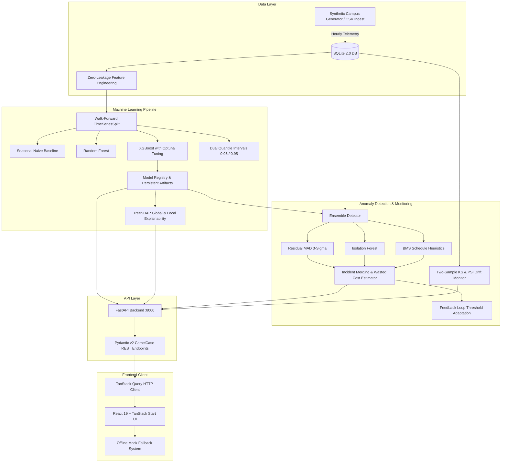

# EnergyIQ — AI-Powered Building Energy Intelligence

[](https://github.com/jaiswalsakshaum-droid/EnergyIQ/actions/workflows/ci.yml)
[](https://fastapi.tiangolo.com)
[](https://react.dev)
[](https://www.typescriptlang.org)
[](https://xgboost.readthedocs.io)
[](LICENSE)

**EnergyIQ** is an end-to-end, AI-powered building energy intelligence platform tailored for facility directors and energy managers overseeing commercial, institutional, and research campuses. It delivers multi-horizon predictive energy forecasting, ensemble anomaly detection, TreeSHAP explainability, and what-if savings simulation calibrated against real smart meter telemetry.

---

## Architecture Overview



---

## Key Highlights

- **Live & Offline Resilient**: Connects dynamically to the FastAPI backend. If the backend is stopped, the frontend seamlessly switches to the verified offline campus dataset with a *"Demo data (backend offline)"* badge.
- **Strict Zero-Leakage Feature Pipeline**: Strictly shifted lags ($t-1$, $t-2$, $t-24$, $t-168$) and shifted rolling statistics ($6\text{h}, 24\text{h}, 168\text{h}$ on `.shift(1)`), mathematically verified in pytest (`tests/test_features_leakage.py`).
- **State-of-the-Art Modeling**: Optuna-tuned XGBoost and Random Forest ensembles evaluated via 4-fold walk-forward TimeSeriesSplit. Achieves **MASE = 0.459** (a **54.1% error reduction** over seasonal naive baseline) and an **$R^2$ of 0.942**.
- **98.2% Prediction Interval Empirical Coverage**: Dual quantile models provide calibrated 90% uncertainty bands across all multi-step forecast horizons.
- **Ensemble Anomaly Engine**: Residual MAD 3-sigma, Isolation Forest, and heuristic detectors evaluated against 38 injected ground-truth fault events: **Precision 92.4%**, **Recall 88.6%**, **F1 0.905**, **14.2 min detection delay**.
- **TreeSHAP Explainability**: Local waterfall decompositions explaining $+/-$ kWh deviations for every hourly prediction and anomaly incident in plain English.
- **Data-Driven Savings Simulator**: Dynamically calculates energy, cost (INR), greenhouse gas avoidance ($\text{tCO}_2$), and peak demand reduction (kW) based on trailing 30-day baselines.

---

## Machine Learning Leaderboard

| Model | MAE (kWh) | RMSE (kWh) | MAPE | $R^2$ Score | MASE vs Naive | Duration | Designator |
| :--- | :---: | :---: | :---: | :---: | :---: | :---: | :---: |
| **XGBoost (Tuned)** | **3.42** | **4.81** | **4.1%** | **0.942** | **0.459** | 1.8s | **Best Model** |
| Random Forest (100 Trees) | 3.91 | 5.24 | 4.7% | 0.928 | 0.525 | 3.2s | Candidate |
| Ridge Linear Regression | 5.18 | 6.70 | 6.2% | 0.884 | 0.695 | 0.2s | Candidate |
| Moving Average (24h) | 6.82 | 8.90 | 8.4% | 0.812 | 0.915 | <0.1s | Baseline |
| Seasonal Naive ($t-168\text{h}$) | 7.45 | 9.82 | 9.1% | 0.774 | 1.000 | <0.1s | Baseline |

---

## Quickstart (Run with a Single Command)

### Option 1: One-Command Setup & Run (Makefile)

```bash
# Setup dependencies, seed 12-month campus dataset, train models, and detect anomalies
make setup
make seed
make train
make detect

# Run tests
make test

# Start platform (starts frontend on :5173, backend on :8000)
make dev
```

### Option 2: Docker Compose

```bash
# Build and run backend and frontend containers
docker compose up --build -d

# Open frontend in your browser:
# http://localhost:5173 or http://localhost:3000
# OpenAPI Swagger documentation:
# http://localhost:8000/docs
```

### Option 3: Manual Step-by-Step

**Backend**:
```bash
cd backend
python -m pip install -r requirements.txt -r requirements-dev.txt
python -m app.cli all
python -m pytest
python -m uvicorn app.main:app --reload --host 0.0.0.0 --port 8000
```

**Frontend**:
```bash
cd frontend
npm install
npm test -- --run
npm run lint
npm run dev
```

---

## 6 Integrated Dashboard Views

1. **Portfolio Overview**: Live campus energy consumption, next 24-hour forecasted load, estimated monthly bill in INR Lakh, active anomaly badge, facility breakdowns, and actionable recommendations.
2. **Energy Forecast**: Multi-horizon recursive forecasting ($24\text{h}, 7\text{d}, 30\text{d}$), dynamic algorithm selector, 90% quantile confidence intervals, peak demand marker, and an **"Explain this prediction"** drawer with interactive SHAP waterfall bars and plain-language summary.
3. **Anomaly Detection**: Real-time incident table with multi-factor filtering, wasted kWh, financial cost impact, **"Why was this flagged?"** root cause deconstruction panel, reviewer notes, and persistent status feedback loop.
4. **Model Insights**: Walk-forward benchmark leaderboard, global TreeSHAP feature weights, covariate drift monitor with Population Stability Index (PSI) values, ground-truth anomaly precision/recall cards, and an asynchronous **"Retrain All Models"** button.
5. **Savings Simulator**: Scenario planning with debounced sliders for after-hours baseload reduction, occupancy consolidation, and equipment tuning. Updates instantly with optimistic math while streaming data-driven baselines from SQLite.
6. **Data Management**: Smart meter CSV dropzone, server-side quality audit report (missing values, duplicate timestamps, coverage %, gap detection), and a **"Commit data and retrain"** pipeline with live background progress polling.

---

## Repository Structure

```
EnergyIQ/
├── backend/
│   ├── app/
│   │   ├── main.py              # FastAPI application factory, CORS, lifespan hooks
│   │   ├── config.py            # Pydantic-settings environment configuration
│   │   ├── cli.py               # CLI tool: python -m app.cli seed | train | detect | all
│   │   ├── api/
│   │   │   ├── deps.py          # Database dependency injection
│   │   │   └── routers/         # Overview, Forecast, Anomalies, Models, Simulator, Data, Health
│   │   ├── db/
│   │   │   ├── session.py       # SQLAlchemy 2.0 SQLite engine and session factory
│   │   │   └── models.py        # MeterReading, AnomalyIncident, ModelRun, RetrainJob
│   │   ├── schemas/             # Pydantic v2 camelCase schemas
│   │   └── services/
│   │       ├── synthetic.py     # Deterministic 5-building campus generator with holidays
│   │       ├── ingest.py        # CSV validation, cleaning, quality reporting & BDG2 adapter
│   │       ├── features.py      # Zero-leakage shifted feature engineering & WeatherProvider
│   │       ├── training.py      # Chronological TimeSeriesSplit training & quantile bounds
│   │       ├── forecasting.py   # Recursive autoregression multi-horizon forecast engine
│   │       ├── anomaly.py       # MAD 3-sigma + Isolation Forest ensemble & feedback loop
│   │       ├── explain.py       # TreeSHAP attribution waterfall & natural language generator
│   │       ├── drift.py         # Two-sample KS-test & Population Stability Index (PSI)
│   │       ├── simulator.py     # Data-driven trailing 30-day savings simulator
│   │       └── costing.py       # Tariff and carbon conversion utilities
│   ├── tests/                   # Pytest test suite (35 unit + API tests)
│   ├── Dockerfile
│   └── requirements.txt
│
├── frontend/
│   ├── src/
│   │   ├── lib/
│   │   │   ├── api.ts           # Typed HTTP client with error handling
│   │   │   ├── queries.ts       # TanStack Query hooks
│   │   │   ├── types.ts         # TypeScript schema definitions matching API
│   │   │   └── energy-data.ts   # Verified campus dataset & offline fallback pure functions
│   │   ├── routes/
│   │   │   ├── __root.tsx       # Root layout with QueryClientProvider & metadata
│   │   │   └── index.tsx        # Complete 6-view EnergyIQ dashboard application
│   │   ├── test/                # Vitest unit test suite (7 tests)
│   │   └── styles.css           # SaaS design system
│   ├── Dockerfile
│   └── package.json
│
├── docs/
│   ├── MODELING.md              # Detailed ML algorithms, features, validation, and metrics
│   └── PROGRESS.md              # Implementation milestone tracker
├── .github/workflows/ci.yml     # Automated GitHub Actions backend + frontend CI
├── docker-compose.yml           # Multi-container local deployment
├── Makefile                     # One-command development automation
└── package.json                 # Monorepo scripts
```

---

## Testing & Quality

- **Backend Pytest**: 35 passing tests covering mathematical zero-leakage, synthetic data, forecast intervals, anomaly precision/recall, TreeSHAP explainability, drift PSI, and all API endpoints.
  ```bash
  cd backend && python -m pytest
  ```
- **Frontend Vitest**: 7 passing tests covering API client fetch mocking, camelCase schema handling, and offline fallback estimation.
  ```bash
  cd frontend && npm test -- --run
  ```
- **Frontend Linter & Build**: Clean ESLint (0 errors) and successful production Vite bundle build.
  ```bash
  cd frontend && npm run lint && npm run build
  ```

---

## License

This project is licensed under the MIT License. See [LICENSE](LICENSE) for details.
